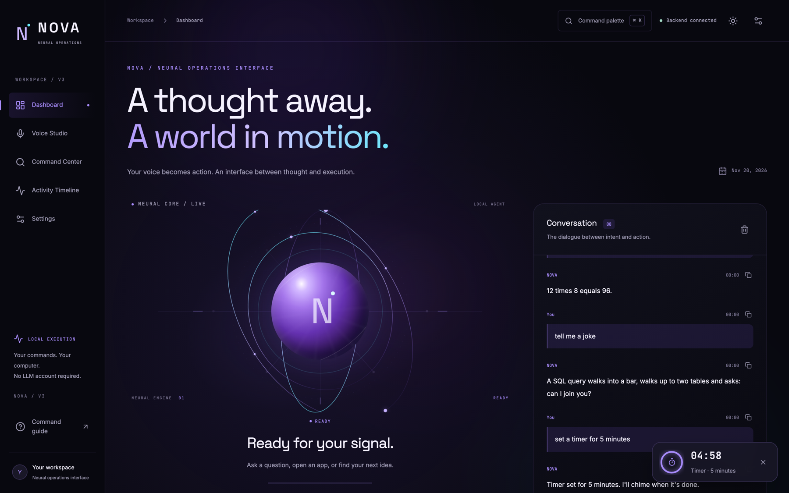
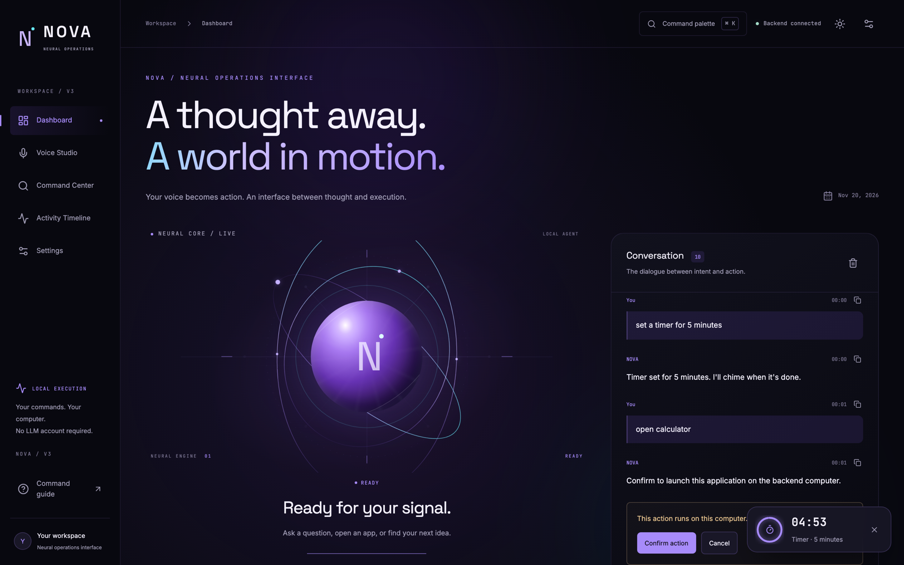
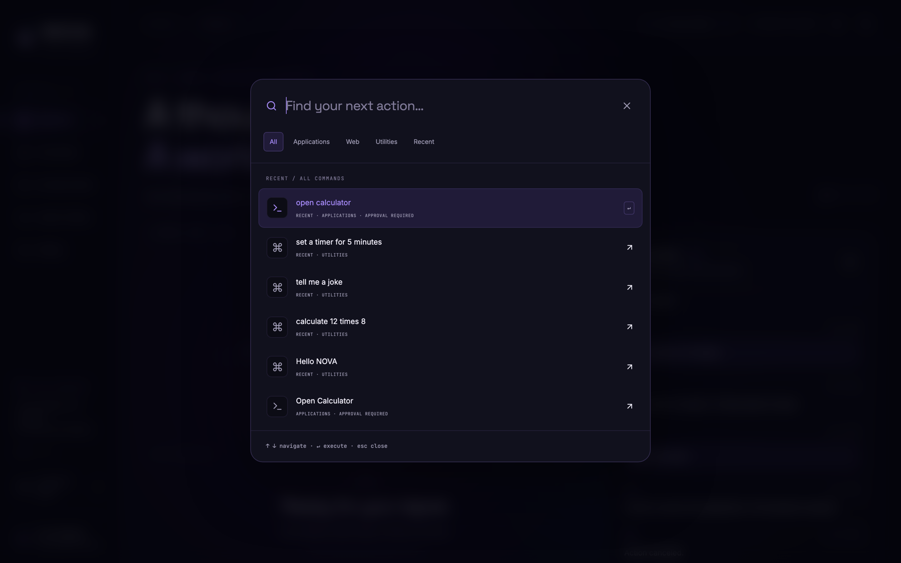
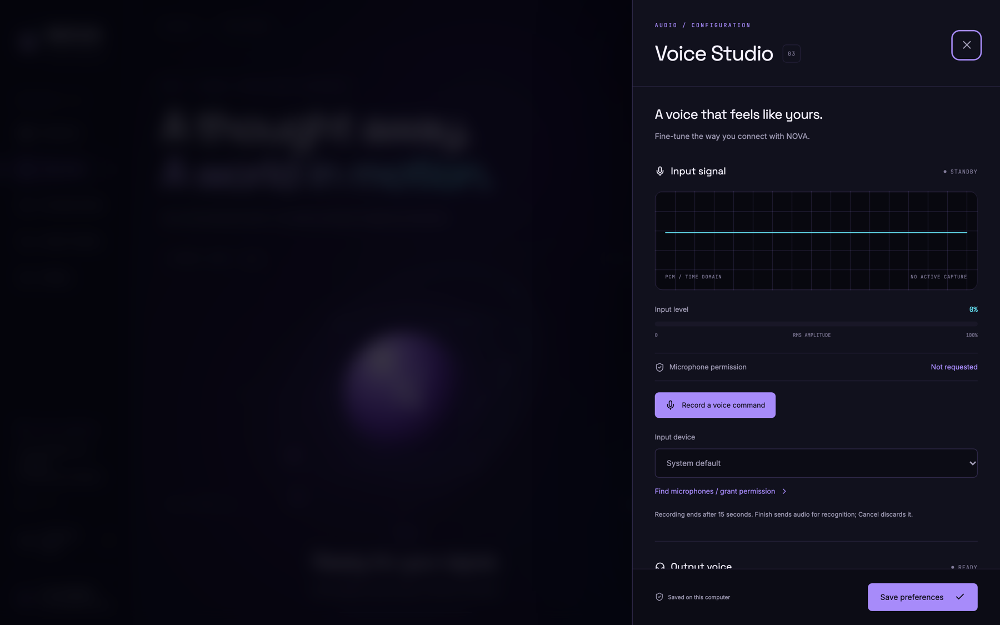
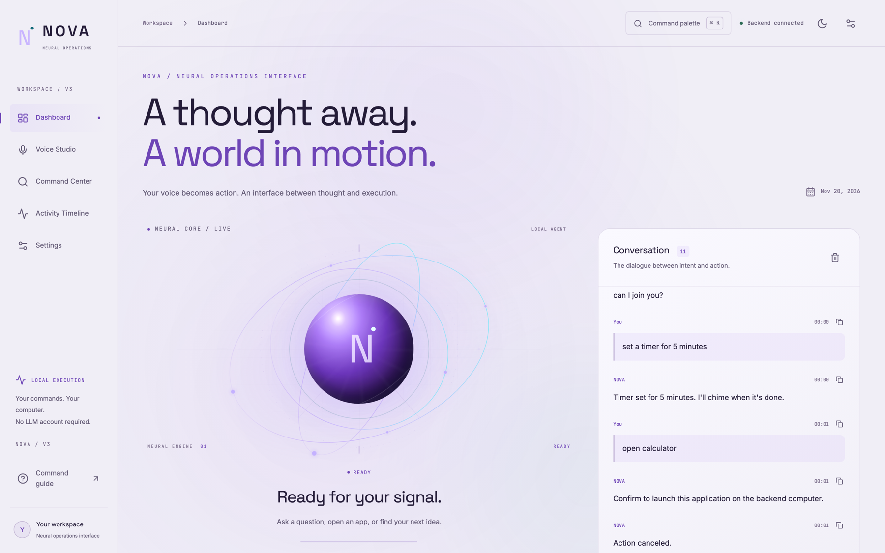
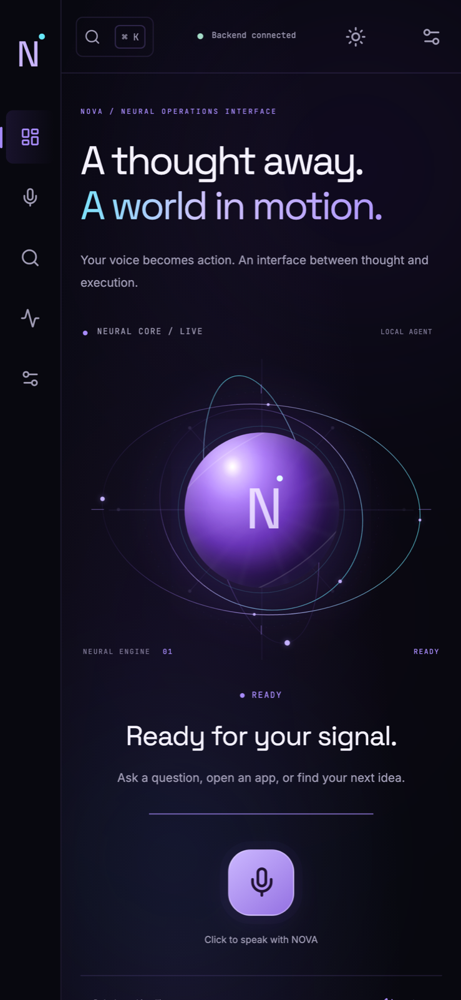
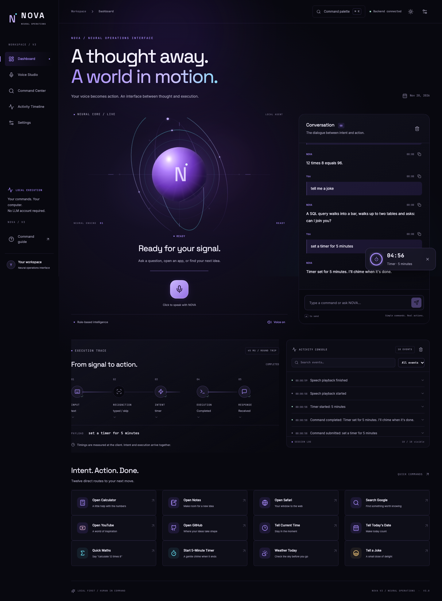
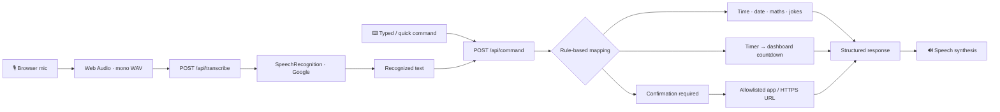

<div align="center">


# NOVA — Personal Voice Assistant

**A thought away. A world in motion.**

A local, rule-based voice assistant with a cinematic neural dashboard.<br/>
Speak or type. NOVA tells the time, opens apps, searches the web, does maths and sets timers, then answers out loud.

<p>
  
  
  
  
  
</p>
<p>
  
  
  
  
</p>



</div>

---

## ✦ Project brief — all requirements met

| Requirement | How NOVA does it |
| :-- | :-- |
| 🎙️ **Speech-to-text** | Browser microphone → mono WAV → **SpeechRecognition** (Google recognizer). The CLI uses `sr.Microphone` directly. |
| 🧭 **Rule mapping to actions** | `handle_command()` maps phrases to **open app**, **search web**, **tell time/date** and more. Apps and sites come from a fixed allowlist, and nothing you say is ever run as a shell command. |
| 🔊 **Text-to-speech** | **pyttsx3** in the CLI, browser speech synthesis in the dashboard (voice picker, rate, mute). |
| 🛡️ **Robust error handling** | Clear messages for denied/missing mic, silent or unclear audio, recognition offline, timeouts, backend down, app not installed and invalid input. |
| 📋 **Sample commands list** | `help` lists them, quick-command cards, a ⌘K command palette and the table [below](#-what-you-can-say). |

---

## ✦ Highlights

<table>
<tr>
<td width="50%" valign="top">

### 🌌 Living interface
- Orbital **neural core** that reacts to real microphone level, processing, speaking and errors
- **Aurora background** whose glow follows NOVA's state
- Shimmering headline, cursor-tracking glow on cards, spring-animated panels
- Midnight and daylight themes, respects *reduced motion*

</td>
<td width="50%" valign="top">

### ⚡ Useful, offline features
- **Calculator**: "calculate 12 times 8", "what is 15 percent of 240" (safe AST parser, no `eval`)
- **Timers**: floating countdown with a progress ring, chime and spoken alert
- Jokes, coin flip, dice roll, small talk
- Wikipedia, YouTube, weather and Google search

</td>
</tr>
<tr>
<td width="50%" valign="top">

### 🔐 Safe by design
- App and browser actions **wait for your confirmation**
- Only allowlisted apps and HTTPS hosts
- Backend bound to `127.0.0.1`, rejects foreign origins and hosts
- Strict request validation, size-limited audio

</td>
<td width="50%" valign="top">

### 🧪 Observable
- **Execution trace**: input → recognition → intent → execution → response, with measured latency
- Searchable **activity console**
- **Voice Studio**: live waveform, input level, mic picker, voice preview
- ⌘/Ctrl + K **command palette**

</td>
</tr>
</table>

---

## ✦ Gallery

<table>
<tr>
<td width="50%"><p align="center"><sub><b>Human in command</b>: actions wait for approval</sub></p></td>
<td width="50%"><p align="center"><sub><b>Command palette</b>: ⌘K, filters, recent commands</sub></p></td>
</tr>
<tr>
<td width="50%"><p align="center"><sub><b>Voice Studio</b>: waveform, level meter, devices</sub></p></td>
<td width="50%"><p align="center"><sub><b>Daylight theme</b></sub></p></td>
</tr>
</table>

<table>
<tr>
<td width="32%" valign="top"><p align="center"><sub><b>Responsive</b>: phone layout</sub></p></td>
<td width="68%" valign="top"><p align="center"><sub><b>Full dashboard</b>: core, conversation, trace, console and 12 quick commands</sub></p></td>
</tr>
</table>

---

## ✦ Quick start

> **Requirements:** Python 3.12, Node 22+, a microphone, and internet for speech recognition.
> On Apple Silicon Macs also run `brew install flac` (the setup script does it for you).

```bash
git clone https://github.com/yasmeenmh90-beep/Syntecxhub_Personal_Voice_Assistant.git
cd Syntecxhub_Personal_Voice_Assistant

bash scripts/setup-macos.sh     # creates .venv, installs Python + npm packages, checks flac
bash scripts/start-local.sh     # starts backend (:8000) and dashboard (:5173); Ctrl+C stops both
```

Then open **http://127.0.0.1:5173** in **Chrome or Safari** and wait for *Backend connected*.

<details>
<summary><b>Manual setup (any OS)</b></summary>

```bash
python3.12 -m venv .venv
source .venv/bin/activate          # Windows: .venv\Scripts\activate
pip install -r requirements-dev.txt
npm --prefix frontend ci

# terminal 1: backend
python -m uvicorn backend.main:app --host 127.0.0.1 --port 8000 --reload

# terminal 2: dashboard
npm --prefix frontend run dev
```

</details>

<details>
<summary><b>Command-line version (no browser)</b></summary>

```bash
pip install -r requirements-cli.txt   # SpeechRecognition[audio] + pyttsx3 (macOS: brew install portaudio)
python assistant.py                   # voice mode
python assistant.py --text --mute     # type commands, no speech output
```

Grant microphone access to your terminal under **System Settings → Privacy & Security → Microphone**.

</details>

---

## ✦ What you can say

Commands are case-insensitive and accept a "hey NOVA" prefix.

| Category | Try saying | What happens |
| :-- | :-- | :-- |
| 👋 Greeting | `Hello NOVA` · `Who are you` · `How are you` | Friendly reply |
| 🕒 Time & date | `What time is it` · `What's today's date` · `What day is it` | Read from the system clock |
| 🧮 Maths | `Calculate 12 times 8` · `What is 15 percent of 240` · `Calculate 2 to the power of 10` | Offline answer |
| ⏱️ Timers | `Set a timer for 5 minutes` · `Set a timer for ten seconds` | Countdown, chime, spoken alert |
| 🖥️ Apps | `Open Calculator` · `Open Notes` · `Open Safari` · `Open Terminal` | Launches after you confirm |
| 🌐 Web | `Open YouTube` · `Open GitHub` · `Open Wikipedia` · `Open Maps` | Opens after you confirm |
| 🔎 Search | `Search for Python tutorials` · `Search YouTube for machine learning` | Google / YouTube results |
| 📚 Knowledge | `Search Wikipedia for black holes` · `Who is Ada Lovelace` | Wikipedia search |
| 🎵 Media | `Play lofi music on YouTube` | YouTube results |
| ☀️ Weather | `Weather in London` · `Weather today` | Google forecast |
| 🎲 Fun | `Tell me a joke` · `Flip a coin` · `Roll a dice` | Random answer |
| ❓ Help | `Help` · `What can you do` | Lists the sample commands |
| 👋 Exit | `Goodbye` · `Exit` | Ends the interaction |

---

## ✦ How it works



- The **browser** owns the microphone and speakers. Python never assumes its own mic is yours.
- Audio is sent to Google for recognition (internet needed) and is **never saved**.
- The UI state machine is **Ready → Listening → Processing → Speaking → Completed**, plus **Error**. Recording can't overlap a command or playback.

<details>
<summary><b>Backend API</b></summary>

| Method / path | Purpose |
| :-- | :-- |
| `GET /api/health` | Readiness and transcription capability |
| `GET /api/commands` | Sample commands |
| `POST /api/command` | `{ "text": "open notes", "confirmed": false }` → `status`, `message`, `ended`, `action` |
| `GET / PUT /api/settings` | Read / validate and atomically save preferences |
| `GET /api/voices` | Client speech capability |
| `POST /api/transcribe` | Mono 16-bit PCM WAV, ≤ 20 s / 4 MB → `{ "text": … }` |

`status` is `completed`, `error` or `confirmation_required`. Timers return `action: { "type": "timer", "target": "<seconds>" }`. Invalid input, bad audio, silent recordings and launch failures return HTTP 422 with a readable `detail`; oversized audio returns 413.

</details>

<details>
<summary><b>Project layout</b></summary>

```text
assistant.py              CLI + shared rule-based command engine (calculator, timers, jokes…)
backend/
  main.py                 FastAPI routes, origin/host checks, error handlers
  commands.py             Structured dispatch, confirmation, timer actions
  launcher.py             Bundle-verified app allowlist
  web_actions.py          HTTPS host allowlist
  speech.py               WAV validation, silence detection, Google recognition
  settings.py             Validated, atomic preference storage
frontend/src/
  App.tsx                 Dashboard, voice flow, conversation, quick commands
  Workspace.tsx           Neural core, command palette, execution trace, console
  VoiceStudio.tsx         Microphone and voice settings
  Timers.tsx              Countdown dock, progress ring, chime
  audio.ts                Browser capture, level metering, WAV encoding
  style.css               Themes and animation
scripts/                  setup, start, doctor and integration checks
tests/                    Python unit and API tests
```

</details>

---

## ✦ Testing

```bash
source .venv/bin/activate
python -m pytest -q               # 51 Python tests: commands, API, security, speech errors
npm --prefix frontend run lint
npm --prefix frontend run build   # TypeScript check + production build
npm --prefix frontend test        # 42 frontend tests: UI flows, voice lifecycle, timers
python scripts/check_integration.py   # live HTTP checks (servers running)
```

Tests mock OS launches and the recognition service; hand-check the real microphone, speakers and app launches using [docs/VERIFICATION.md](docs/VERIFICATION.md).

---

## ✦ Troubleshooting

<details>
<summary><b>Show common fixes</b></summary>

| Problem | Fix |
| :-- | :-- |
| *"This browser does not provide microphone access"* / *"embedded preview blocks the microphone"* | Open http://127.0.0.1:5173 in **Chrome or Safari**, not an editor's built-in preview. |
| Microphone denied | Allow the site in browser settings, and the browser under macOS **Privacy & Security → Microphone**. |
| *"Unexpected backend error"* / *"Audio encoder failed (FLAC)"* | Apple Silicon: SpeechRecognition's bundled `flac-mac` is Intel-only. Run `brew install flac`, restart the backend. |
| *"The recording was silent"* | The mic sent no sound. Pick the right input in Voice Studio and watch the level bars move. |
| *"Speech was unclear"* | Sound was captured but not understood. Speak closer, then click **Finish** right after speaking. |
| Recognition service unavailable | Check your internet; typed commands still work. |
| Backend offline | Start Uvicorn on 127.0.0.1:8000; the dashboard retries every 10 s. |
| App not installed | Install the allowlisted app; NOVA reports launch failures instead of claiming success. |
| Settings won't save | Check write access to `data/` or set `NOVA_SETTINGS_PATH`. |

</details>

## ✦ Limitations

- Rule-based, not an LLM: phrases outside the rules get a polite "not recognized". Matching is prefix-based, so any sentence starting with "play …" becomes a YouTube search and "who is …" becomes a Wikipedia search.
- Recognition needs internet (Google). Recordings are limited to 15 s and are recognized on **Finish**, with no wake word or streaming transcripts.
- Timers live in the browser tab and are lost on reload; the CLI prints its timer alert in the terminal.
- Actions run on the computer running the backend, so keep the dashboard and backend on the same machine.

<div align="center">
<br/>
<sub>Built for the <b>Syntecxhub</b> internship · Week 4 · Project 1</sub><br/>
<sub>LOCAL FIRST / HUMAN IN COMMAND</sub>
</div>
