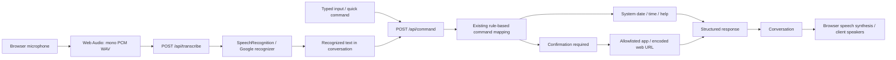

# NOVA / Neural Operations Interface

A local voice assistant with a cinematic neural workspace, measured execution telemetry, and a Python rule-based command engine. Speak or type to check the time, launch an allowlisted app, or search the web. No external LLM, API key, Docker, or Electron is required.

The original Python CLI remains available. The dashboard shares its command mapping, adding structured results, action confirmation, validated settings, and accurate application launch errors.

## Features

- Responsive obsidian and lavender workspace, custom NOVA mark, orbital neural core, and cyan highlights.
- Neural core follows idle, measured microphone amplitude, processing, playback start/end, success, and error states. Speaking uses playback state, not fabricated audio frequencies.
- Cmd/Ctrl + K command palette: fuzzy search, categories, recent session commands, arrow navigation, Enter, Escape, focus restoration and trapping.
- Execution trace shows input source, recognition/skipped status, returned action classification, approval, response, and measured HTTP round-trip latency. The API returns intent/execution together; intermediate backend events and per-stage latency are not invented.
- Bounded activity console records connection changes, capture, recognized speech, submissions, approvals, results, and playback events. Activity Timeline expands the session log.
- Voice Studio includes actual browser voices, preview, speaking rate, mute, microphone discovery/selection, input level meter, and recording controls.
- Ambient aurora background that reacts to NOVA's state (listening, processing, speaking, error) and a shimmering headline.
- Timers with a floating countdown dock: animated progress ring, Web Audio chime, spoken alert and cancel/dismiss.
- Offline utilities: safe arithmetic calculator (no `eval`; whitelisted AST only), jokes, coin flip, dice roll, small talk.
- Daylight/midnight themes, keyboard focus indicators, reduced-motion support, and CSS animation suspension in hidden tabs.
- Conversation with real responses, timestamps, copy, clear, and auto-scroll. History is kept only in memory and clears on reload.
- Twelve animated quick commands (staggered entrance, cursor-tracking glow), typed input with Enter, backend availability checks, visible failures.
- Browser microphone selection and permission requests; mono WAV capture, finish/cancel controls, 15-second capture limit, recognition timeout, no overlapping sessions.
- Browser speech synthesis with actual client voice enumeration, speaking events, rate control, mute, stop, and default-voice fallback.
- App/browser actions require a confirmation click. Arbitrary shell execution is never supported.
- Settings persist atomically in `data/settings.json` (override with `NOVA_SETTINGS_PATH`).

## Stack and architecture

React, TypeScript, Vite, Tailwind CSS, Lucide, Motion; FastAPI, Pydantic, SpeechRecognition, Python standard libraries. Optional CLI audio uses PyAudio and pyttsx3.



Microphone and speakers belong to the browser's device. Python never assumes its microphone is the browser's microphone. WAV bytes go to the local backend, then to Google's recognition service, requiring internet; no audio files are saved. Dashboard speech is generated on the client and can therefore be heard by the user. pyttsx3 remains the CLI provider, not an inaudible server playback path. Some browser voices may use online services.

HTTP is sufficient for bounded recognition requests and local synthesis events; no WebSocket is needed. The frontend owns Ready → Listening → Processing → Speaking → Completed → Ready, plus Error. Capture cannot overlap a command or playback. Cancel discards the recording; Finish submits it. Action confirmation pauses execution before launching anything. Completion means the OS/browser accepted the launch, not that a webpage finished loading.

## Installation on macOS

Use Python **3.12** (recommended for audio compatibility) and Node **22 LTS or newer**. Install these first if missing. Run from the project root:

```bash
cd /Users/yasmeenazmatali/Documents/SynTexHub-Internship/week4/Project1/NOVA_Voice_Assistant
python3.12 -m venv .venv
source .venv/bin/activate
python -m pip install --upgrade pip
python -m pip install -r requirements-dev.txt
cd frontend
npm ci
cd ..
```

The dashboard requires neither PyAudio nor PortAudio: the browser captures audio. This keeps native dependencies optional.

### Local setup and supervised startup

Run these from the project root **in your own Mac Terminal**. The helper installs the existing project requirements into `.venv` and runs `npm ci` only in `frontend/`:

```bash
bash scripts/setup-macos.sh
bash scripts/start-local.sh
```

The startup helper checks dependencies and occupied ports, starts both servers, verifies the backend health endpoint **through both ports**, and keeps them in the foreground. Ctrl+C stops only its own two processes. If either service fails, its companion stops too. It does not kill unrelated services or silently choose different ports. Its shell syntax has been checked; actual service startup remains blocked in the Codex sandbox.

For optional **CLI** PyAudio / pyttsx3 support:

```bash
brew install portaudio
bash scripts/setup-macos.sh --native-audio
.venv/bin/python scripts/doctor.py --microphones
```

PortAudio/PyAudio are not required for dashboard browser recording. Device enumeration does not prove recording or permission is working. With servers running, inspect real dependencies, installed allowlisted apps, and both health URLs:

```bash
.venv/bin/python scripts/doctor.py
.venv/bin/python scripts/check_integration.py
# This flag actually requests all three app launches:
.venv/bin/python scripts/doctor.py --launch-apps
```

Calculator and Notes are resolved from their system app bundles; Safari's Cryptex symlink is resolved. Bundle identifiers and executable presence are validated against the allowlist. This avoids relying on app-name lookup. If LaunchServices rejects an installed bundle, NOVA reports that rejection explicitly. Both CLI and dashboard share this implementation.

### Backend startup — terminal 1

```bash
cd /Users/yasmeenazmatali/Documents/SynTexHub-Internship/week4/Project1/NOVA_Voice_Assistant
source .venv/bin/activate
python -m uvicorn backend.main:app --host 127.0.0.1 --port 8000 --reload
```

### Frontend startup — terminal 2

```bash
cd /Users/yasmeenazmatali/Documents/SynTexHub-Internship/week4/Project1/NOVA_Voice_Assistant/frontend
npm run dev
```

Open **http://127.0.0.1:5173**. Wait for “Backend connected.” Use localhost rather than a LAN address for microphone access. Vite proxies `/api` to port 8000. FastAPI accepts CORS only from `http://127.0.0.1:5173` and `http://localhost:5173`, rejects untrusted mutation origins and Host values, and should remain bound to loopback. This is a single-user local tool, not an authenticated remote service.

### Existing CLI

```bash
source .venv/bin/activate
python assistant.py --text --mute
# Optional native microphone and speech output:
python -m pip install -r requirements-cli.txt
python assistant.py
```

If optional PyAudio installation fails, `brew install portaudio`, then retry `requirements-cli.txt`. Grant microphone permission to your browser for the dashboard, or your terminal for the CLI, under **System Settings → Privacy & Security → Microphone**.

## Example commands

| Say or type | Result |
| --- | --- |
| Hello NOVA | Greeting |
| What time is it? | System time |
| What's today's date? | System date |
| Open Calculator | Calculator launch after confirmation |
| Open Notes | Notes launch after confirmation |
| Open Safari | Native Safari on macOS, after confirmation |
| Open YouTube / Open GitHub / Open browser | Default browser, after confirmation |
| Search for Python tutorials | URL-encoded Google results, after confirmation |
| Search YouTube for machine learning | URL-encoded YouTube results, after confirmation |
| Open Terminal | Preserved CLI command; dashboard requires confirmation |
| Calculate 12 times 8 / What is 15 percent of 240 | Safe offline arithmetic (spoken operators, %, powers) |
| Set a timer for 5 minutes | Countdown dock with chime and spoken alert (1 s – 24 h) |
| Search Wikipedia for black holes | Wikipedia search, after confirmation |
| Play lofi music on YouTube | YouTube results, after confirmation |
| Weather in London / Weather today | Google forecast, after confirmation |
| Tell me a joke / Flip a coin / Roll a dice | Offline fun responses |
| Who are you / How are you / What day is it | Small talk and day of week |
| Help | Supported command list |
| Goodbye / exit | End the current interaction; dashboard stays available |

Commands are case-insensitive and accept the existing “hey NOVA” prefix. This is an extensible command assistant, not a general conversation model. Search Google’s card fills the input so you can enter your own query.

## Backend API

| Method / path | Purpose |
| --- | --- |
| GET `/api/health` | Readiness, audio architecture, and installed transcription capability |
| GET `/api/commands` | Supported examples |
| POST `/api/command` | `{ "text": "open notes", "confirmed": false }` |
| GET / PUT `/api/settings` | Read / validate and atomically persist preferences |
| GET `/api/voices` | Client synthesis capability; voice list comes from the browser |
| POST `/api/transcribe` | Raw mono 16-bit PCM WAV, up to 20 seconds / 4 MB |

Command results have `status`, `message`, `ended`, and `action`. Status is `completed`, `error`, or `confirmation_required`. HTTP 422 identifies invalid input, malformed audio, unavailable recognition, and launch failures; oversized audio returns 413. Unexpected failures log to the backend terminal and return HTTP 500. Unsupported commands return an explicit structured error. Browser/devices are enumerated on the client, never invented by the backend.

## Project layout

```text
assistant.py                 Original CLI and reusable command mapping
backend/
  main.py                    FastAPI endpoints, origin checks, error handlers, logging
  commands.py                Structured dispatch and explicit action confirmation
  launcher.py                Bundle-verified allowlist and checked macOS launches
  web_actions.py             URL allowlist and browser acceptance checks
  speech.py                  WAV validation and Google transcription
  tts.py                     Client playback capability description
  settings.py                Validated, atomic preference persistence
frontend/src/
  App.tsx                    Dashboard, voice state flow, conversation, preferences
  Workspace.tsx              Neural core, command palette, execution trace and activity console
  api.ts                     Typed API client and settings models
  audio.ts                   Browser capture, level measurement, WAV encoding
  style.css                  Responsive themes and animation
  App.test.tsx               Component interaction and audio lifecycle tests
scripts/check_integration.py Live HTTP checks without mocks
scripts/doctor.py            Dependencies, app discovery, health, optional native devices
scripts/setup-macos.sh       Project-local dependency installation
scripts/start-local.sh       Foreground supervisor for both services
tests/                       Existing and new backend tests
docs/VERIFICATION.md         Recorded results and manual acceptance steps
```

## Testing

```bash
source .venv/bin/activate
python -m unittest discover -s tests -v
cd frontend
npm run lint
npm run build
npm test -- --pool=forks --poolOptions.forks.singleFork
cd ..
# With BOTH development servers running:
python scripts/check_integration.py
```

Unit tests isolate OS launches and recognition-service failures with mocks. API tests use the real ASGI app in process; they are not a substitute for live HTTP integration. The separate integration script makes real socket requests, checks the Vite proxy, validates safe commands and errors, changes then restores settings, and never launches apps. Use the manual checklist for actual browser, microphone, playback, search, and launch verification.

## Screenshots and verification

[Desktop](docs/screenshots/nova-desktop.png) · [Mobile](docs/screenshots/nova-mobile.png)

Headless Chrome was used to inspect the rendered interface at 1440, 850, and 390 CSS pixels. All three matched the document width without horizontal overflow. A real typed time command, command palette, and approval cancellation were exercised. TypeScript, ESLint, production build, all 42 frontend tests, and all 50 Python tests passed. Live HTTP integration passed against the services already running on ports 8000 and 5173. See [verification details and hardware checklist](docs/VERIFICATION.md).

## Troubleshooting

| Problem | What to do |
| --- | --- |
| Backend offline | Start Uvicorn from the project root on 127.0.0.1:8000. The dashboard retries every 10 seconds. |
| Microphone denied | Allow the site's microphone in browser settings and the browser in macOS Privacy & Security. Retry the mic button. |
| No microphone / selected device removed | Select System default, reconnect the microphone, and use Find microphones in Preferences. |
| Silence / unclear speech | Speak close to the mic, reduce noise, then click Finish recording. Retry with a short clear command. |
| Recognition service unavailable | Check internet access. Audio is sent to Google's recognizer; typed local commands remain available. |
| Voice unavailable / playback failed | Choose Browser default or another reported voice, check system output, and verify browser speech support. Voice failures never erase the response. |
| No voice list yet | Browser voices may populate asynchronously. Reopen Preferences after the system has loaded voices. |
| App not installed | Install the allowlisted app or choose an available command. macOS launch failures are shown rather than reported as success. |
| Settings cannot save | Check write access to `data/`, or set `NOVA_SETTINGS_PATH` to a writable JSON file path. |
| Cannot bind port / EPERM | Run in a terminal that permits local servers. A sandbox may deny sockets even when dependencies are installed. |
| npm / pip DNS errors | Restore registry network access and rerun installation. Do not interpret an installation failure as a test pass. |

## Limitations

Live speech, audible output, microphone device selection, and successful OS application launches still need target-machine verification. No real application was launched during redesign verification. Browser layouts and live HTTP were verified with elevated local access; see [docs/VERIFICATION.md](docs/VERIFICATION.md).

Rule matching is prefix-based, so some phrases are broad: any sentence starting with “play …” becomes a YouTube search, and “who is …”, “what is a …” and “tell me about …” become Wikipedia searches. “What is …” is treated as a calculation only when it contains a number. Timers live in the browser tab and are lost on reload; the CLI prints its timer alert in the terminal.

No wake-word background listener, streaming transcription, general LLM, native packaging, or persistent conversation storage is included. The capture implementation uses the widely supported but deprecated ScriptProcessorNode; an AudioWorklet migration is appropriate before broader distribution. The UI records up to 15 seconds and recognizes on Finish or timeout, rather than streaming partial transcripts or automatically detecting sentence endings. Cancellation stops capture, but a recognition request already sent to Google cannot be recalled. Actions execute on the backend computer, so keep frontend and backend on the same Mac. App/browser acceptance does not verify a remote website loaded or that internet is available. Saved microphone/voice identifiers can become unavailable; choose System/Browser default to recover.
